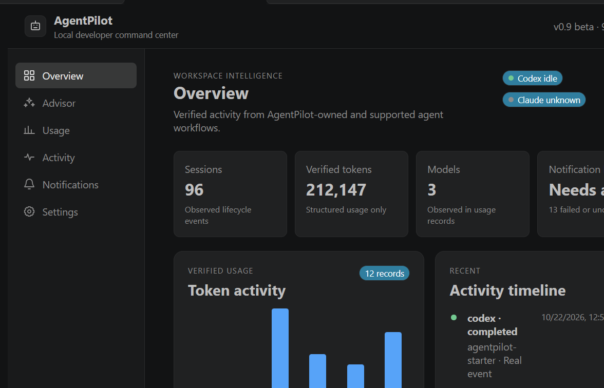
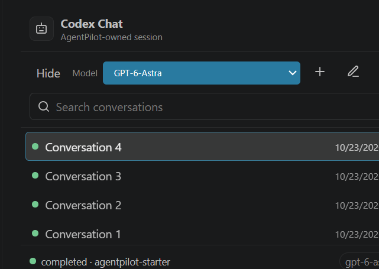
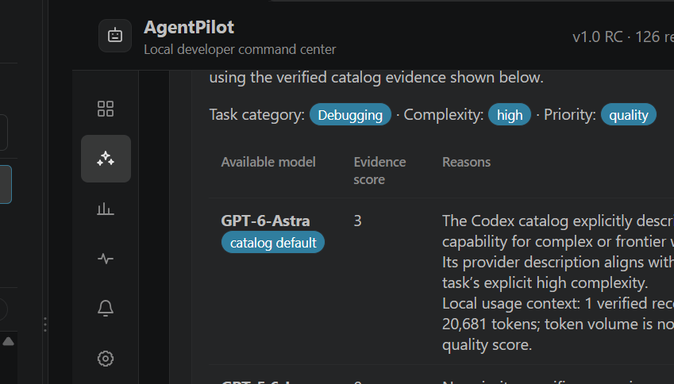
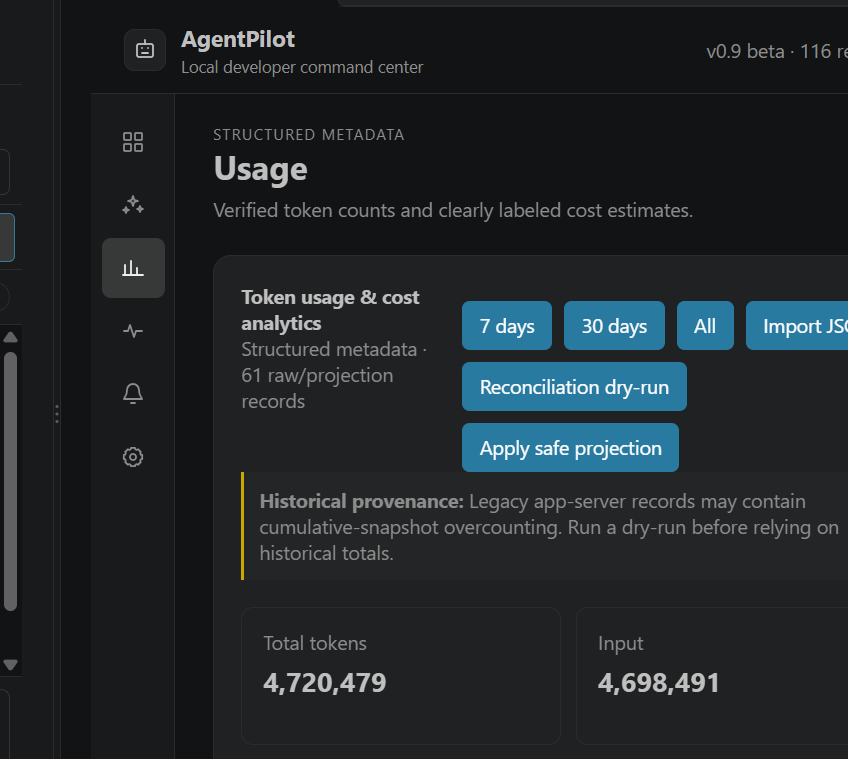
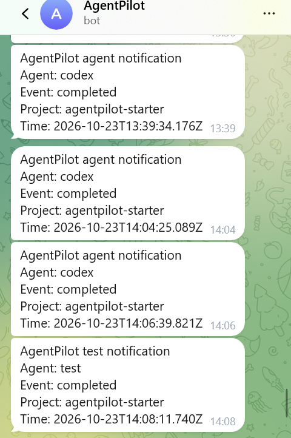

# AgentPilot

**A local-first control center for Codex tasks, usage, and notifications in VS Code.**

[](https://github.com/Aissarak8/agentpilot/releases/tag/v1.0.0-rc.1)
[](LICENSE)

[**Download AgentPilot v1.0.0-rc.1 (VSIX)**](https://github.com/Aissarak8/agentpilot/releases/download/v1.0.0-rc.1/agentpilot-1.0.0-rc.1.vsix) · [Release notes](https://github.com/Aissarak8/agentpilot/releases/tag/v1.0.0-rc.1) · [Documentation](#documentation) · [Report an issue](https://github.com/Aissarak8/agentpilot/issues)

AgentPilot helps developers run and observe supported coding-agent workflows without sending project data to an AgentPilot service. It provides an AgentPilot-owned Codex chat, an explainable model advisor, verified token metadata, lifecycle history, and optional VS Code, Windows, and Telegram notifications.

The current build is **`1.0.0-rc.1`**, a release candidate for testing. It is not a stable v1.0 release and is not published to the VS Code Marketplace.

## Features

- **Interactive Codex Chat:** start and resume AgentPilot-owned Codex app-server conversations from the sidebar. Message text remains in Extension Host memory; only bounded session metadata is stored by AgentPilot.
- **Model selection and Smart Model Advisor:** choose models reported by the owned app-server or get deterministic, local recommendations with visible evidence and limitations.
- **Usage analytics:** view explicit input, output, cached-input, and reasoning-token fields when a supported structured source exposes them. Optional cost figures are estimates.
- **Lifecycle monitoring:** observe supported Codex CLI hooks, AgentPilot-owned CLI tasks, and AgentPilot-owned app-server sessions. Test events remain visibly distinct.
- **Independent notifications:** use VS Code notifications, optional Windows desktop notifications, or an optional Telegram bot delivery queue.
- **Local-first privacy:** event and usage metadata remain under your local profile. Telegram secrets use VS Code SecretStorage.
- **Secure execution:** workspace trust, startup confirmation, Codex sandbox settings, and individual command/file/permission approvals are preserved. AgentPilot never auto-approves requests.

## Screenshots

These are real AgentPilot sessions, not mockups. Historical beta captures are labeled and their totals are not current billing.

### Dashboard overview



_Historical v0.9 beta capture. Displayed event and token totals are test-history values, not current billing._

### AgentPilot-owned Codex Chat



_Privacy-cropped to exclude conversation content and a local filesystem path._

### Smart Model Advisor



### Usage analytics



_Historical v0.9 beta capture. Legacy totals are illustrative test data and may include documented cumulative-snapshot uncertainty; they are not provider billing or verified pricing._

### Telegram notifications



_Metadata-only test and completion notifications; no token or chat ID is shown._

## Quick start

1. [Download the release-candidate VSIX](https://github.com/Aissarak8/agentpilot/releases/download/v1.0.0-rc.1/agentpilot-1.0.0-rc.1.vsix).
2. In VS Code, open **Extensions → Views and More Actions (…) → Install from VSIX…**, select the download, then reload.
3. Open a project folder and trust it only after reviewing the workspace.
4. Run **AgentPilot: Open Dashboard**. Opening the Dashboard does not start Codex.
5. Open **AgentPilot: Open Codex Chat**, select an available model, and send a harmless first task.
6. Review the startup confirmation and every command, file-change, or permission request. Denial is always safe.
7. View lifecycle activity and token metadata; optionally enable Windows or Telegram notifications.

Continue with the [Installation Guide](docs/INSTALLATION.md) and [User Guide](docs/USER_GUIDE.md).

## Requirements

- Windows 11 is the currently tested desktop platform.
- VS Code `1.90.0` or newer (declared by the extension manifest).
- Node.js 22 is the tested source-build environment.
- An installed, authenticated official Codex CLI/native executable for Codex Chat and task-running features.
- PowerShell for native Windows notifications.

AgentPilot uses Codex authentication only through supported Codex processes. It does not read or store authentication tokens.

## Installation

### Install the GitHub pre-release

Download [`agentpilot-1.0.0-rc.1.vsix`](https://github.com/Aissarak8/agentpilot/releases/download/v1.0.0-rc.1/agentpilot-1.0.0-rc.1.vsix) from the official pre-release:

1. Verify that the file came from a source you trust.
2. In VS Code, open **Extensions**.
3. Select **Views and More Actions (…) → Install from VSIX…**.
4. Choose `agentpilot-1.0.0-rc.1.vsix`.
5. Run **Developer: Reload Window** when prompted.

### Build from source

```powershell
git clone https://github.com/Aissarak8/agentpilot.git
cd agentpilot
npm install
npm test
npm run package:rc
code --install-extension .\agentpilot-1.0.0-rc.1.vsix
```

The packaging command uses the pinned `@vscode/vsce@4.0.0` CLI through `npx`, so the first run requires npm registry access. Reload VS Code after installation. See [Installation](docs/INSTALLATION.md) for Codex executable setup and verification.

## Telegram setup

1. In Telegram, contact the verified **@BotFather**, create a bot, and keep its token private.
2. Start a conversation with the new bot. Obtain the destination's numeric chat ID through a trusted Telegram workflow, or use a valid public channel username.
3. Run **AgentPilot: Configure Telegram Bot Token**. AgentPilot validates it with `getMe` and stores it in SecretStorage.
4. Run **AgentPilot: Configure Telegram Chat ID**.
5. Enable `AgentPilot: Enable Telegram` in Settings or the Dashboard.
6. Run **AgentPilot: Test Telegram Notification** and confirm receipt.

Never paste a token into source files, settings JSON, terminal history, logs, screenshots, or issue reports. See [Telegram Setup](docs/TELEGRAM_SETUP.md) for error meanings and safe diagnostics.

## Supported monitoring and limitations

- AgentPilot can monitor configured supported Codex CLI hooks and sessions/tasks that AgentPilot starts and owns.
- AgentPilot **cannot independently read or monitor private conversations owned by the official Codex VS Code extension**. It does not attach to that extension's private app-server, scrape its UI, or intercept traffic.
- Claude-related event/usage support is limited to explicitly configured supported inputs; AgentPilot does not claim general Claude Code session monitoring.
- Token counts are recorded only from explicit structured fields. Estimates do not represent ChatGPT subscription billing or provider invoices.
- Legacy historical usage may be uncertain. Reconciliation is previewed and explicitly approved; it is never applied automatically and does not rewrite the original usage store.
- Model Advisor results are explainable local heuristics based on available metadata, not independent model benchmarks.
- Status is derived from observed events, not continuous process surveillance.
- Telegram `sendMessage` has no general client idempotency key. A timed-out delivery is marked **uncertain** and is never automatically resent.
- Codex sandbox and approval restrictions are never bypassed.

## Local data and privacy

AgentPilot stores bounded metadata in `%USERPROFILE%\.agentpilot`, including event history, usage records, task/session metadata, notification claims, Advisor feedback, and Telegram delivery state. It does not intentionally store prompts, source code, assistant responses, transcripts, Codex credentials, Telegram credentials, or raw private event payloads.

Telegram delivery necessarily sends a short metadata-only message—agent name, event type, project name, and timestamp—to Telegram when enabled. See [Architecture](docs/ARCHITECTURE.md) and [Security Policy](SECURITY.md).

## Troubleshooting

- **Codex executable not found:** set `AgentPilot: Codex CLI Path` to an absolute native `codex.exe`. Windows `.cmd` and `.bat` launchers are intentionally rejected.
- **Native package missing:** repair the official Codex installation using its supported installer; do not copy binaries from an untrusted source.
- **Workspace not trusted:** review the project, then use VS Code's workspace-trust UI. AgentPilot will not execute tasks while untrusted.
- **Models unavailable:** authorize the AgentPilot-owned Chat process, confirm Codex authentication, and inspect **View → Output → AgentPilot** for sanitized categories.
- **Approval denied:** the turn may stop or fail. Start a new turn and approve only the specific safe request.
- **Telegram errors:** run **AgentPilot: Diagnose Telegram Connectivity**; HTTP 401 means an invalid token, 403 means access is forbidden, 429 is rate limiting, and timeout/network categories may be uncertain for sends.
- **No Windows toast:** enable Windows notifications, run **AgentPilot: Test Windows Notification**, and check Windows notification/Focus Assist settings.
- **No usage data:** complete an AgentPilot-owned structured CLI or app-server turn. Lifecycle hooks alone may not expose token usage.

More detail is available in [Troubleshooting](docs/TROUBLESHOOTING.md).

## Documentation

- [Installation](docs/INSTALLATION.md)
- [User Guide](docs/USER_GUIDE.md)
- [Telegram Setup](docs/TELEGRAM_SETUP.md)
- [Troubleshooting](docs/TROUBLESHOOTING.md)
- [Architecture](docs/ARCHITECTURE.md)
- [Contributing](CONTRIBUTING.md)
- [Security Policy](SECURITY.md)
- [Release Candidate Readiness](RELEASE_READINESS_REPORT.md)

## Development

```powershell
npm install
npm test
npm run package:rc
```

The test suite uses Node's built-in test runner. The project intentionally avoids a heavy frontend framework.

## Contributing

Fork the repository, create a focused branch, add tests, run the complete suite, and open a pull request. Please use GitHub Issues for reproducible bugs without including prompts, credentials, source code, or private logs. Read [CONTRIBUTING.md](CONTRIBUTING.md) first.

## License

AgentPilot is available under the [MIT License](LICENSE). Copyright is attributed to AgentPilot contributors.
